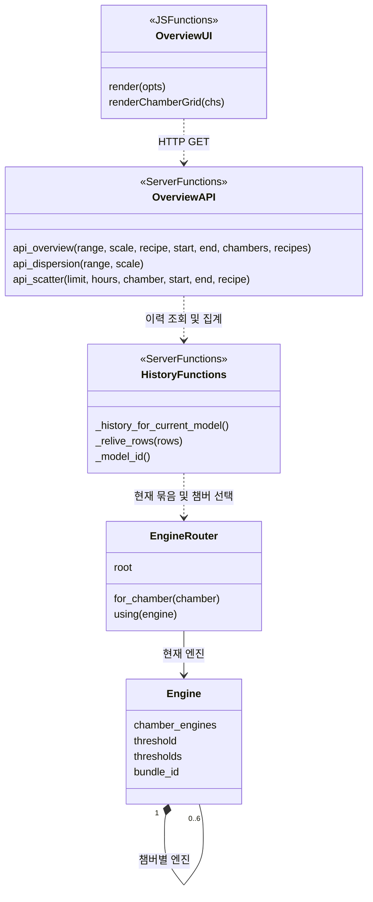
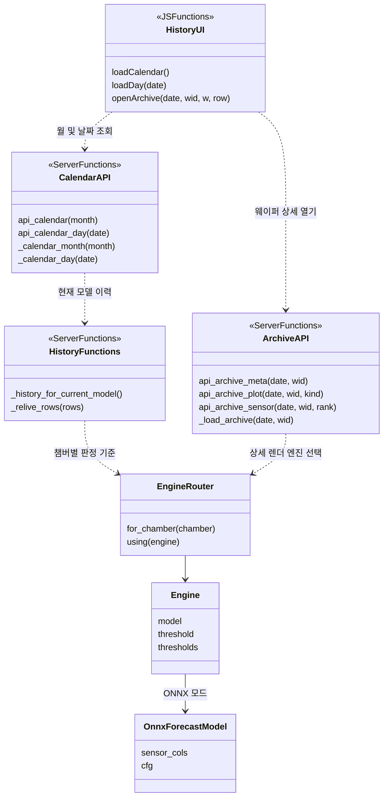
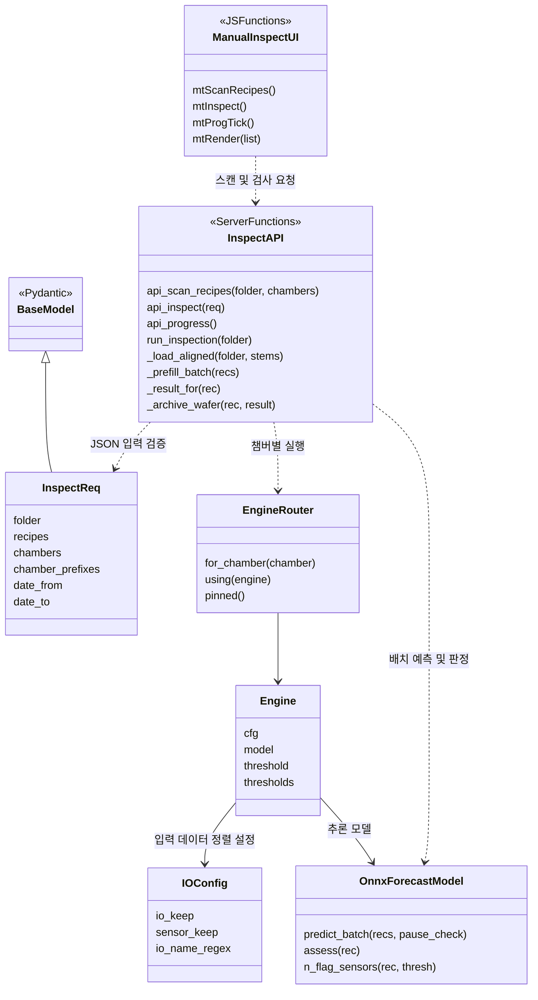
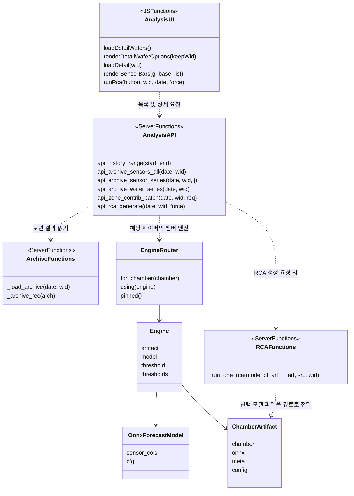

# 화면별 클래스 다이어그램 — 오버뷰·이력검색·개별검사·이상분석

작성일: 2026-09-09 · 구현 기준: `83b3744`

현재 앱은 화면별 Controller/View 클래스를 따로 정의하지 않고 JavaScript 함수와 FastAPI 함수로 화면을 구현한다.
아래 그림은 **실제 클래스와 화면별 함수 묶음을 구분한 설계용 클래스 다이어그램**이다.
`<<JSFunctions>>`, `<<ServerFunctions>>`는 설명을 위한 함수 묶음이며 구현 클래스명이 아니다.
나머지 `EngineRouter`, `Engine`, `OnnxForecastModel`, `IOConfig`, 요청 모델은 실제 클래스다.
`..>`는 사용·호출 의존, `-->`는 객체 참조, `*--`는 하위 엔진 소유, `<|--`는 상속을 뜻한다.

## 1. 오버뷰

| 구성 | 역할 |
|---|---|
| 화면 함수 | 기간·집계 단위·챔버·레시피 조건으로 챔버 현황, 불량률 추이, 산포·산점 결과 표시 |
| API 함수 | 조건에 맞는 이력을 시간 구간·챔버별로 집계 |
| 이력 함수 | 현재 모델 묶음의 이력 선택, 챔버별 임계로 표시 판정 계산 |
| `EngineRouter`, `Engine` | 조회 대상 모델과 각 챔버의 임계값 제공 |

주요 인터페이스: GET `/api/overview`, `/api/dispersion`, `/api/scatter`.
기본 조회는 저장된 검사 이력을 사용한다. 개요를 조회할 때마다 원본 웨이퍼를 다시 배치 추론하는 구조는 아니다.
그림의 API 인자는 주요 항목만 발췌했으며 `/api/overview`의 실제 Python 인자 `rng`는 HTTP에서 `range`로 받는다.

## 2. 이력검색

| 구성 | 역할 |
|---|---|
| 달력 화면·API | 월별 검사 현황과 선택 날짜의 웨이퍼 목록 제공 |
| 아카이브 API | 날짜·웨이퍼 ID로 보관된 NPZ 메타정보와 상세 그림 조회 |
| 이력 함수 | 현재 모델에 해당하는 이력으로 조회 범위 제한 |
| 모델 클래스 | 상세 렌더링에 필요한 해당 챔버의 센서 스키마와 판정 기준 제공 |

주요 인터페이스: GET `/api/calendar?month=...`, `/api/calendar/day/{date}`, `/api/archive/{date}/{wid}`,
`/api/archive/{date}/{wid}/plot/{kind}`, `/api/archive/{date}/{wid}/sensor/{rank}`.
이력 인덱스는 메모리 자료구조이고 영속 원본은 NPZ다. 이를 별도 데이터베이스 또는 Repository 클래스가 있는 것으로 해석하지 않는다.

## 3. 개별검사

| 구성 | 역할 |
|---|---|
| `mtScanRecipes`, `mtInspect` | 폴더의 레시피 목록 확인 후 선택 조건으로 검사 요청 |
| `InspectReq` | 폴더·레시피·기간 등 입력 데이터의 형식 검증 |
| 검사 함수 | 파일 탐색, 필터, 챔버별 데이터 정렬, 배치 실행, 결과·아카이브 반영 |
| `EngineRouter`, `Engine` | C2 챔버 값에 맞는 모델·설정·임계 연결 |
| `OnnxForecastModel` | 동일 챔버의 여러 웨이퍼를 배치 추론하고 웨이퍼별 결과 제공 |

주요 인터페이스: GET `/api/scan-recipes`, POST `/api/inspect`, GET `/api/progress`.
검사 제어 API는 POST `/api/inspect/pause`와 `/api/inspect/abort`이며, 일시정지 요청은 `PauseReq(paused)`를 사용한다.
C2의 PMCUNIT7~12는 DSV1~6으로 대응한다. DSV별 하위 모델 폴더를 사용하며 모델 파일 접두사 방식은 지원하지 않는다.
배치 이후 점수와 아카이브를 웨이퍼별로 작성하는 과정은 개별 추론을 반복한다는 뜻이 아니다. 예측 캐시를 재사용한다.

## 4. 이상분석

| 구성 | 역할 |
|---|---|
| 웨이퍼 목록 | 기간 내 웨이퍼를 종료 시각 오름차순으로 표시하고 LOT 첫 번째 항목 표시 |
| 센서 상세 | NPZ에 저장된 실제값·기대값·오차와 해당 챔버의 센서 스키마로 시계열·기여도 구성 |
| 모델 선택 | `_wafer_model` 함수 데코레이터와 `EngineRouter`가 조회하는 웨이퍼의 챔버별 문맥 유지 |
| RCA 실행 | 사용자가 RCA 생성을 요청한 경우 원본 또는 아카이브에서 복원한 데이터와 모델 파일로 별도 분석 |

주요 인터페이스: GET `/api/history/range`, `/api/archive/{date}/{wid}/sensors-all`,
`/api/archive/{date}/{wid}/sensor-series/{j}`, `/api/archive/{date}/{wid}/wafer-series`;
POST `/api/archive/{date}/{wid}/zone-contrib-batch`, `/api/rca/{date}/{wid}`.
`_run_one_rca()`가 `ChamberArtifact` 객체를 직접 인자로 받는 것은 아니다. 챔버별 아티팩트에서 만든 경로를 전달받는 간접 의존을 표시했다.
기본 센서 상세 조회와 RCA 생성은 별도 동작이다. RCA는 사용자 요청 시 수행한다.

## 구현 파일 대응

| 파일 | 내용 |
|---|---|
| `src/app/static/index.html` | 네 화면의 JavaScript 함수·화면 구성 |
| `src/app/server.py` | API 함수, 검사·이력·아카이브·RCA 함수, `Engine`, 요청 모델 |
| `src/app/chamber_models.py` | `EngineRouter`, `ChamberArtifact` |
| `src/onnx_backend_forecast.py` | `OnnxForecastModel` |
| `src/config.py` | `IOConfig` |

공통 속성·메서드는 읽기 쉬운 범위로 발췌했다. 다이어그램은 현재 구현의 책임과 관계를 설명하며,
화면별로 새로운 Python 클래스 네 개를 추가했다는 의미는 아니다.
